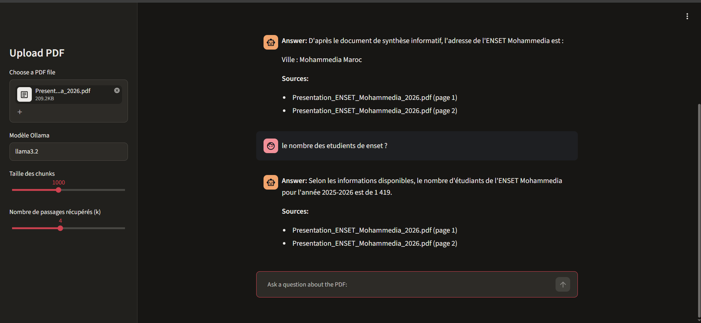
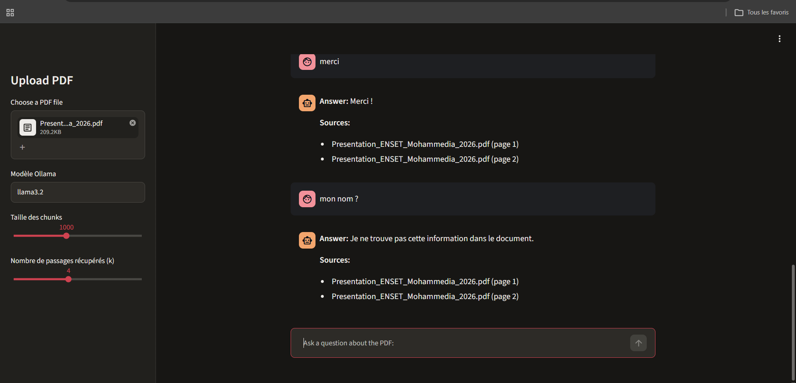
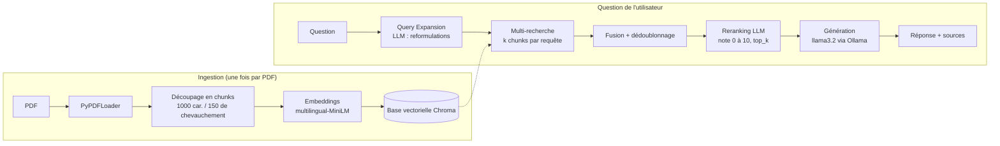
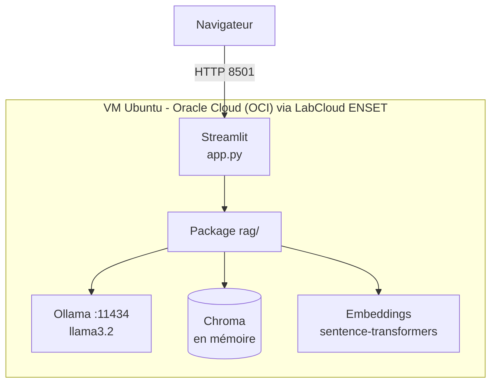
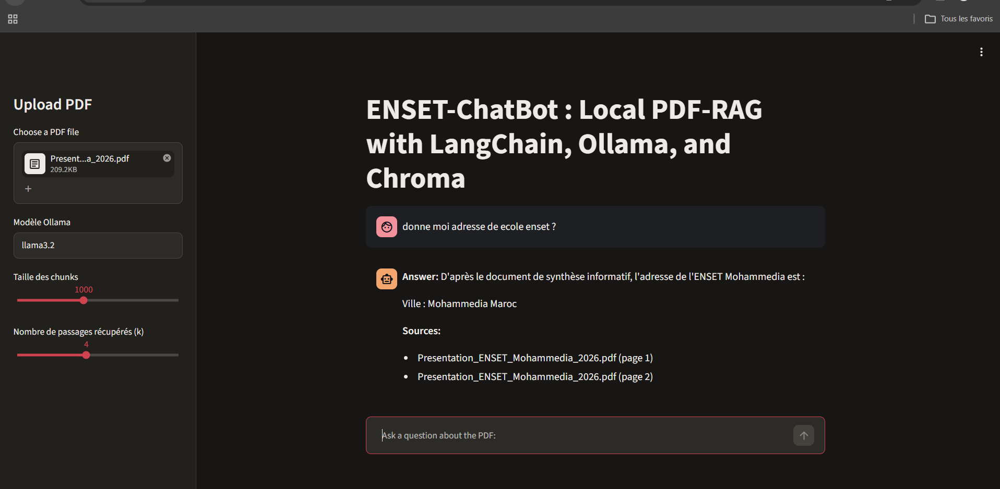

# ENSET RAG ChatBot

**Un chatbot qui répond aux questions sur un PDF, 100 % en local** : LLM Ollama, base vectorielle Chroma, interface Streamlit. L'application est déployée sur une **machine virtuelle Oracle Cloud (OCI)** et inclut un **RAG avancé** (Query Expansion + Reranking) comparable au RAG classique.


---

## Sommaire

1. [Contexte](#contexte)
2. [Fonctionnalités](#fonctionnalités)
3. [Démo](#démo)
4. [Architecture](#architecture)
5. [Comment ça fonctionne](#comment-ça-fonctionne)
6. [Déploiement sur une VM Oracle Cloud](#déploiement-sur-une-vm-oracle-cloud)
7. [Installation locale](#installation-locale)
8. [Configuration](#configuration)
9. [Structure du projet](#structure-du-projet)
10. [Tests](#tests)
11. [Limites connues](#limites-connues)
12. [Pistes d'amélioration](#pistes-damélioration)
13. [Auteur](#auteur)

---

## Contexte

Projet réalisé à l'**ENSET Mohammedia** (Université Hassan II de Casablanca), classe **BDCC-3**, dans le cadre du cours d'IA générative encadré par le **Pr. OUHMIDA Asmae**. Le code de départ (RAG classique avec Streamlit, LangChain, Ollama et Chroma) est fourni par la professeure ; l'analyse, les améliorations, le RAG avancé, les tests, la documentation et le déploiement sont réalisés par l'auteur.

**Problème traité :** un LLM ne connaît pas le contenu d'un document qu'on vient de lui donner. Le **RAG** (*Retrieval-Augmented Generation*) lui fournit, à chaque question, les passages pertinents du document pour qu'il réponde à partir de ces passages, avec ses sources, sans envoyer de données à un service externe.

## Fonctionnalités

- **Questions sur un PDF** avec réponse en français et **sources** (nom du fichier et numéro de page).
- **100 % local** : LLM servi par Ollama, embeddings et base vectorielle exécutés sur la machine.
- **Trois modes** : RAG classique, RAG amélioré, ou **comparaison côte à côte** (réponses, sources, temps et détail des étapes).
- **RAG amélioré** : *Query Expansion* (reformulations générées par le LLM) puis *Reranking* (note de pertinence de 0 à 10 par chunk).
- **Refus explicite hors document** : si la réponse n'est pas dans le PDF, le chatbot le dit au lieu d'inventer.
- **Transparence** : l'onglet « Détails » montre les requêtes utilisées, les notes de chaque chunk (retenu ou écarté) et le temps de chaque étape.
- **Paramétrable depuis l'interface** : modèle Ollama, taille des chunks, nombre de passages, nombre de reformulations.
- **Qualité logicielle** : code modulaire, tests unitaires sans Ollama, intégration continue GitHub Actions.

## Démo

> Les captures ci-dessous montrent l'application en **RAG classique**, hébergée sur la VM Oracle Cloud, avec le PDF d'exemple fourni dans [`data/sample/`](data/sample/).

**Réponse correcte avec sources**



**Refus quand l'information n'est pas dans le document** (pas d'hallucination)



### Essayer soi-même

1. Lancer l'application ([installation](#installation-locale)).
2. Envoyer `data/sample/Presentation_ENSET_Mohammedia_2026.pdf` dans la barre latérale.
3. Poser des questions, par exemple :

| Question | Réponse attendue (d'après le PDF) |
|---|---|
| En quelle année l'ENSET a-t-elle été fondée ? | Septembre 1985 |
| Combien d'étudiants en 2025-2026 ? | 1 419 |
| À quelle université l'école est-elle rattachée ? | Université Hassan II de Casablanca |
| Combien de laboratoires de recherche ? | 3 |
| Quel est le prix de la scolarité ? | Refus : l'information n'est pas dans le document |

4. Choisir le mode **Comparaison classique vs amélioré** et ouvrir « Détails » pour voir les reformulations et les notes de reranking.

## Architecture



| Composant | Technologie | Rôle |
|---|---|---|
| Interface | Streamlit | Upload du PDF, chat, affichage des réponses et des détails |
| Lecture du PDF | PyPDFLoader (pypdf) | Extraction du texte page par page |
| Découpage | RecursiveCharacterTextSplitter | Chunks de 1000 caractères, 150 de chevauchement |
| Embeddings | sentence-transformers `paraphrase-multilingual-MiniLM-L12-v2` | Vecteurs multilingues (document en français) |
| Base vectorielle | Chroma (en mémoire) | Recherche des chunks les plus proches |
| LLM | Ollama + `llama3.2` (3B) | Reformulation, notation et rédaction de la réponse |

Détails, diagrammes de séquence et choix techniques : [`docs/architecture.md`](docs/architecture.md).

## Comment ça fonctionne

### RAG classique

1. **Ingestion** : le PDF est lu, découpé en chunks, chaque chunk est transformé en vecteur et stocké dans Chroma.
2. **Recherche** : la question est vectorisée ; Chroma renvoie les `top_k` chunks les plus proches.
3. **Génération** : ces chunks sont placés dans un prompt qui impose de répondre uniquement à partir du contexte ; le LLM rédige la réponse.

### RAG amélioré (Query Expansion + Reranking)

1. **Query Expansion** : le LLM reformule la question (par exemple « créée » devient « fondée ») pour retrouver des passages que la formulation d'origine aurait manqués.
2. **Multi-recherche** : une recherche par requête, puis fusion à tour de rôle et **dédoublonnage** ; le nombre de candidats est plafonné (chaque candidat coûte un appel au LLM).
3. **Reranking** : le LLM note chaque candidat de 0 à 10 ; seuls les `top_k` meilleurs sont gardés, ce qui retire du contexte les passages hors sujet.
4. **Génération** : même prompt strict que le RAG classique, avec un contexte plus précis.

L'expansion améliore le **rappel** (trouver plus de passages utiles) ; le reranking améliore la **précision** (ne garder que les bons). Contrepartie : plusieurs appels supplémentaires au LLM, donc un temps de réponse plus long (affiché pour chaque réponse).

### Réduire les hallucinations

- Prompt strict avec phrase de refus : « Je ne sais pas d'après le document fourni. »
- `temperature=0` pour des réponses stables.
- Contexte filtré par le reranking.
- Sources affichées pour vérifier chaque réponse.

## Déploiement sur une VM Oracle Cloud

L'application tourne sur une **machine virtuelle hébergée sur Oracle Cloud Infrastructure (OCI)**, mise à disposition par la plateforme **LabCloud de l'ENSET**.

| Élément | Valeur |
|---|---|
| Hébergement | Machine virtuelle sur Oracle Cloud (OCI), via LabCloud ENSET |
| Système | Ubuntu, accès SSH par clé |
| Processeur | AMD EPYC 9J14 (Genoa), 4 cœurs / 8 vCPU |
| Mémoire / disque | 16 Go de RAM / 200 Go |
| GPU | Aucun : le LLM s'exécute sur CPU |
| Port applicatif | 8501/TCP (Streamlit), ouvert dans la section « Ports ouverts » de LabCloud |
| LLM | Ollama, port 11434 (local à la VM) |



### Mise en place rapide

```bash
# 1. Se connecter à la VM
ssh ubuntu@<IP_PUBLIQUE_DE_LA_VM>

# 2. Récupérer le projet
git clone https://github.com/Fahdkrachel/enset-rag-chatbot.git
cd enset-rag-chatbot

# 3. Tout installer : paquets, Ollama + llama3.2, environnement Python
bash scripts/setup_vm.sh

# 4. Ouvrir le port 8501 (TCP) dans LabCloud, section « Ports ouverts »

# 5. Lancer
bash scripts/run.sh
# puis ouvrir http://<IP_PUBLIQUE_DE_LA_VM>:8501
```

Pour que l'application **redémarre automatiquement avec la VM** (service systemd), pour l'accès par **tunnel SSH** et pour le dépannage, voir [`docs/deploiement-oci.md`](docs/deploiement-oci.md).

> **Sécurité :** Streamlit n'a ni authentification ni HTTPS ici. Ne pas y charger de documents confidentiels sur un port ouvert à tout Internet ; pour un usage privé, préférer le tunnel SSH.

## Installation locale

Prérequis : Python 3.11+ et [Ollama](https://ollama.com/download).

```bash
git clone https://github.com/Fahdkrachel/enset-rag-chatbot.git
cd enset-rag-chatbot

python -m venv venv
source venv/bin/activate            # Windows : venv\Scripts\activate
pip install -r requirements.txt

ollama pull llama3.2
streamlit run app.py                # http://localhost:8501
```

Sans GPU, installer PyTorch en version CPU avant le reste :
`pip install torch --index-url https://download.pytorch.org/whl/cpu`.
Au premier lancement, le modèle d'embedding (environ 500 Mo) est téléchargé.

## Configuration

Variables d'environnement (toutes facultatives) :

| Variable | Valeur par défaut | Rôle |
|---|---|---|
| `OLLAMA_BASE_URL` | `http://localhost:11434` | Adresse du serveur Ollama |
| `OLLAMA_MODEL` | `llama3.2` | Modèle proposé par défaut (modifiable dans l'interface) |
| `OLLAMA_NUM_CTX` | `4096` | Taille du contexte envoyé au LLM |
| `EMBEDDING_MODEL` | `sentence-transformers/paraphrase-multilingual-MiniLM-L12-v2` | Modèle d'embedding |

Les autres paramètres (taille des chunks, `top_k`, nombre de reformulations, candidats max) sont réglables dans la barre latérale ; leurs valeurs par défaut sont dans [`rag/config.py`](rag/config.py).

## Structure du projet

```text
enset-rag-chatbot/
├── app.py                    # Interface Streamlit
├── rag/
│   ├── config.py             # Paramètres par défaut
│   ├── ingestion.py          # PDF -> chunks -> index Chroma
│   ├── retrieval.py          # Query Expansion, fusion, Reranking
│   └── pipeline.py           # RAG classique et RAG amélioré
├── tests/                    # Tests unitaires (sans Ollama)
├── scripts/
│   ├── setup_vm.sh           # Installation complète sur Ubuntu
│   └── run.sh                # Lancement de l'application
├── deploy/
│   └── enset-rag.service     # Service systemd (démarrage automatique)
├── docs/
│   ├── architecture.md       # Diagrammes et choix techniques
│   ├── deploiement-oci.md    # Guide de déploiement sur la VM Oracle Cloud
│   └── images/               # Captures d'écran
├── data/sample/              # PDF d'exemple
├── .github/workflows/ci.yml  # Intégration continue (pytest)
├── requirements.txt
└── LICENSE
```

## Tests

```bash
pip install -r requirements-dev.txt
pytest
```

Les tests couvrent la Query Expansion (nettoyage de la sortie du LLM, repli en cas d'erreur), la fusion et le dédoublonnage, la lecture des notes du reranking et les deux pipelines. Ils utilisent un **faux LLM** : ni Ollama ni GPU nécessaires, ce qui permet de les exécuter dans la CI GitHub Actions.

## Limites connues

- **Performances sur CPU** : sans GPU, chaque appel au LLM prend plusieurs secondes. Le RAG amélioré en fait beaucoup plus que le classique (1 reformulation, jusqu'à 8 notes, 1 réponse) ; l'interface affiche le temps de chaque réponse.
- **Petit modèle** : `llama3.2` (3B) peut se tromper ou répondre de façon incomplète, et ses notes de reranking peuvent être instables. Un reranker dédié (cross-encoder) serait plus fiable et plus rapide.
- **Exemple d'échec observé** (RAG classique) : à la question sur l'adresse de l'école, le chatbot n'a donné que la ville, alors que l'adresse complète figure dans le PDF. Le RAG amélioré a été conçu pour mieux sélectionner les passages, mais une **évaluation comparative chiffrée reste à faire**.

  
- **PDF scannés** : le texte n'est pas extrait sans OCR ; l'application affiche alors un message d'erreur explicite.
- **Un seul PDF à la fois**, base Chroma **en mémoire** : le PDF doit être renvoyé après un redémarrage de l'application.
- **Pas d'authentification** sur l'interface Streamlit.

## Pistes d'amélioration

- [ ] Évaluation chiffrée : jeu de questions de référence, comparaison classique et amélioré (exactitude, refus corrects, temps)
- [ ] Reranker dédié (cross-encoder) à la place du scoring par LLM
- [ ] Persistance de Chroma sur disque et prise en charge de plusieurs PDF
- [ ] OCR pour les PDF scannés
- [ ] Réponses en streaming
- [ ] Conteneurisation (Docker Compose : application + Ollama)
- [ ] Authentification et HTTPS (reverse proxy)

## Auteur

**KRACHEL Fahd** : étudiant à l'ENSET Mohammedia (BDCC-3), Big Data et Cloud Computing, certifié AWS Cloud Practitioner. GitHub : [@Fahdkrachel](https://github.com/Fahdkrachel).

Encadrement et base du TP : Pr. OUHMIDA Asmae.

## Licence

Distribué sous licence [MIT](LICENSE).
