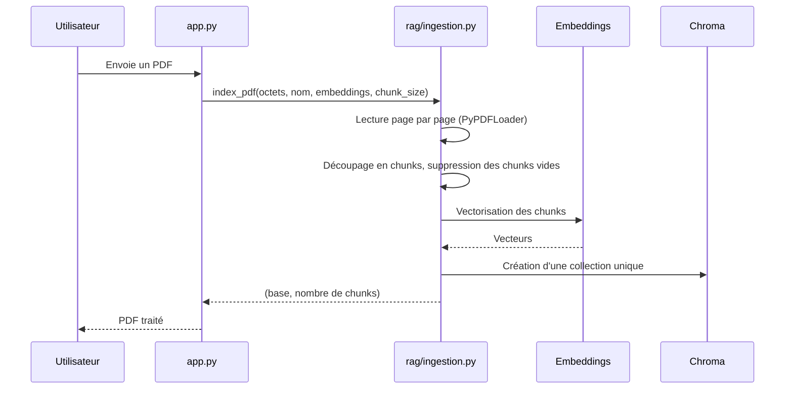
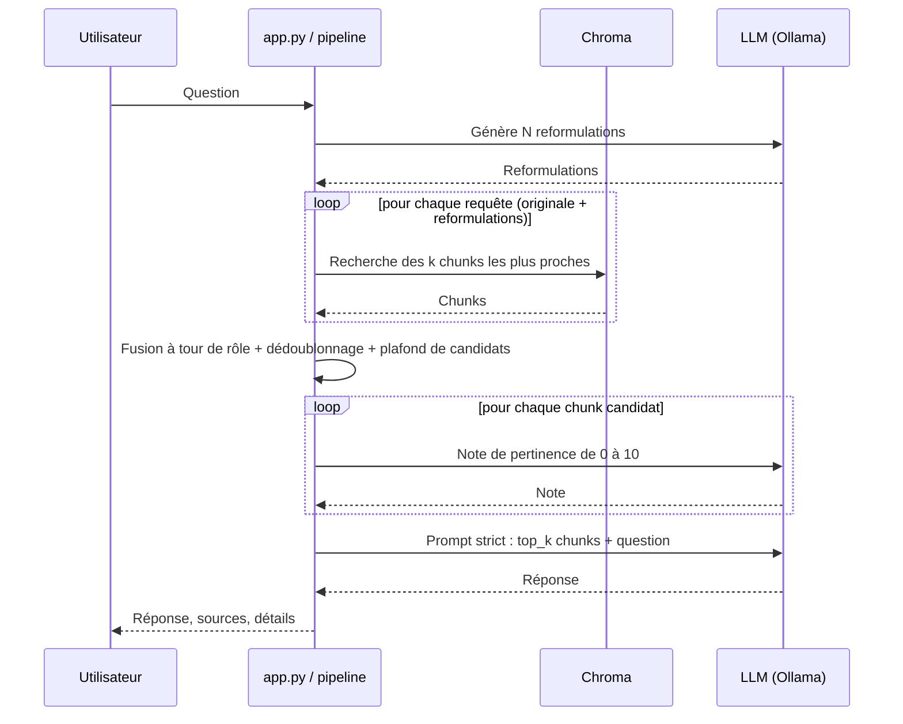

# Architecture

Ce document détaille le fonctionnement interne du ChatBot. Vue d'ensemble : voir le [README](../README.md#architecture).

## Découpage du code

| Module | Responsabilité | Dépendances |
|---|---|---|
| `app.py` | Interface Streamlit : upload, paramètres, chat, affichage | streamlit, `rag.*` |
| `rag/ingestion.py` | PDF, chunks, index Chroma | langchain-community, langchain-text-splitters |
| `rag/retrieval.py` | Query Expansion, fusion/dédoublonnage, Reranking | aucune (Python standard) |
| `rag/pipeline.py` | `run_classic` et `run_advanced`, prompt final, formatage des sources | aucune (Python standard) |
| `rag/config.py` | Valeurs par défaut et variables d'environnement | aucune |

`retrieval.py` et `pipeline.py` ne dépendent ni de LangChain ni de Streamlit : ils reçoivent un objet `llm` (méthode `invoke(prompt) -> str`) et une base `db` (méthode `as_retriever(...)`). Cela permet de les tester avec des objets simulés, sans Ollama.

## Ingestion d'un PDF

Le PDF n'est traité qu'une fois par fichier (clé : nom, taille, taille des chunks) : Streamlit relance tout le script à chaque action, il faut donc mémoriser l'état dans `st.session_state`.

## Question en mode RAG amélioré

Nombre d'appels au LLM : `1 (expansion) + nombre de candidats (au plus MAX_CANDIDATES) + 1 (réponse)`. Le RAG classique n'en fait qu'un.

## Choix techniques

| Décision | Justification |
|---|---|
| **Ollama + llama3.2 (3B)** | Exécution locale, sans clé d'API ni envoi de données ; le modèle tient dans 16 Go de RAM et fonctionne sur CPU. |
| **Embeddings multilingues** | Le modèle par défaut de `HuggingFaceEmbeddings` est surtout entraîné sur l'anglais ; le document est en français. Le modèle choisi est multilingue, plus petit et plus rapide. |
| **Chroma en mémoire, collection unique par PDF** | Simple, sans service à gérer. Un nom de collection unique évite de mélanger les chunks de deux PDF successifs. |
| **Prompt strict + `temperature=0`** | Réduit les réponses inventées : le LLM doit répondre depuis le contexte ou refuser. |
| **Reranking par le LLM** | Aucune dépendance supplémentaire et facile à expliquer ; en contrepartie plus lent et moins fiable qu'un cross-encoder dédié (voir « Pistes d'amélioration »). |
| **Plafond de candidats** | Chaque candidat coûte un appel au LLM sur CPU : limiter à 8 évite des temps de réponse trop longs. |
| **`num_ctx=4096`** | Le contexte par défaut d'Ollama peut être trop court pour 5 chunks de 1000 caractères plus le prompt. |
| **Fusion à tour de rôle** | Si on tronquait la liste dans l'ordre, les résultats de la question d'origine occuperaient toutes les places et les reformulations ne serviraient à rien. |
| **Logique métier sans dépendance externe** | `retrieval.py` et `pipeline.py` se testent avec un faux LLM, donc en CI sans Ollama. |
